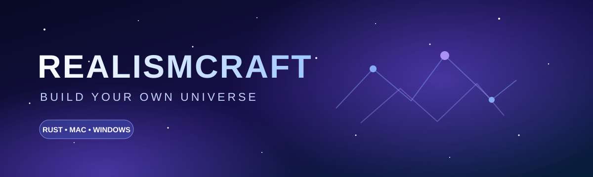

# RealismCraft

<p align="center"></p>

**An original voxel sandbox for macOS and Windows.**

RealismCraft is a standalone block-building game project written in Rust and Macroquad. It is its own game, not a Minecraft client, and does not include Mojang code or assets.


## Current features

- **Account screen:** first launch opens a create-account flow. Returning players can stay signed in between launches; the remembered session never stores the password. The profile is local and works offline.
- **Password handling:** passwords are stored as salted PBKDF2-HMAC-SHA256 hashes, not as readable text.
- **World setup:** choose a world name, enter a seed or generate a random one, choose Natural / Highlands / Islands terrain, and select Survival, Creative, Adventure or Spectator before generating.
- **Expanding procedural world:** deterministic 16×16 chunks generate around the player as they explore, with no fixed horizontal world edge. Natural, Highlands, and Islands presets include beaches, water, snowy areas, and scattered trees.
- **Smooth landscape surface:** natural ground uses a continuous height-field mesh instead of rendering every dirt/grass/stone cube. Trees, water, and player-placed blocks remain separate models.
- **Grass and soil layers:** grass terrain uses a green cap over visible soil edges.
- **World saves:** the current world and placed/removed blocks are saved locally.
- **Material textures:** procedural 128×128 surface textures for grass, dirt, stone, sand, wood, leaves, water, and snow. These are generated materials inspired by real surfaces, not photo-scanned decal packs.
- **Chunk renderer:** 16×16 chunk meshes batch visible block faces by material; buried faces are omitted.
- **Parallel loading:** terrain and CPU mesh construction run on worker threads with Rayon while a loading screen stays responsive.
- **Performance HUD:** FPS and frame-time display, with F3 counters for visible chunks and mesh draw calls.
- **First-person camera:** mouse-look with cursor capture, WASD movement, and vertical controls.
- **Native performance settings:** requests Apple's Metal renderer and an uncapped swap interval where the driver supports it; actual FPS depends on the Mac and scene.
- **Minecraft-style chat:** `/gamemode creative`, `/gamemode survival`, `/gamemode adventure`, `/gamemode spectator`, `/seed`, `/spawn`, and `/help`. The older `!set GameMode ...` syntax remains supported.
- **Block editing:** left click breaks the targeted block; right click places the selected hotbar block. Chunk edits rebuild only the changed chunk.
- **Sound effects:** short original, synthesized place / break / interface sounds are bundled in the game.
- **Galaxy-style menus:** a custom first-run and main menu interface.

## Build from source

### Install on macOS (one command)

This downloads the latest source, builds an optimized native binary on your Mac, creates a custom `.icns` app icon, packages `RealismCraft.app`, and installs it in `/Applications`:

```sh
curl -fsSL https://raw.githubusercontent.com/ttmeticks-source/Script-Converter/main/install-macos.sh | bash
```

The installer requires Rust from [rustup.rs](https://rustup.rs/) and Apple's Command Line Tools. It may ask for your Mac password when copying the app into `/Applications`. Your account and worlds remain in `~/Library/Application Support/RealismCraft/`.

### Windows

Install Rust, then run in PowerShell:

```powershell
git clone https://github.com/ttmeticks-source/Script-Converter.git
cd Script-Converter
cargo run --release
```

## Controls

- **WASD** — move
- **Mouse** — look around (cursor is captured in-world)
- **- (minus key)** — open chat; type `!set GameMode creative` to switch modes
- **Enter** — send the chat command
- **F3** — show/hide renderer counters
- **Space / Left Ctrl** — move up / down
- **Left Shift** — move faster
- **Left click** — place selected block
- **Right click** — remove a nearby block
- **1–8** — select a material
- **Escape** — save and return to the menu

## Local data

The account and world save are kept in the operating system's application data folder:

- **macOS:** `~/Library/Application Support/RealismCraft/`
- **Windows:** `%APPDATA%\\RealismCraft\\`
- **Linux:** `$XDG_DATA_HOME/RealismCraft/` (or `~/.local/share/RealismCraft/`)

The local profile is not connected to an authentication server and cannot be used to sign into a website or multiplayer service.

## Planned next milestones

- Real multiplayer sessions with an explicit protocol/server bridge; current remote avatars are only a visual simulation.
- Further performance work: frustum culling, mesh reuse, and a more advanced GPU backend.
- Higher-detail material maps, lighting, shadows, and ambient effects.
- World selection and multiple save slots.
- More biomes, caves, ores, and structures.
- Skin editor and user-created skins.
- A sandboxed WebAssembly mod runtime. Mods will not receive unrestricted access to the user's computer.
- Optional Pumpkin server adapter; Pumpkin is a separate GPLv3 server, not a renderer dependency. See [Pumpkin integration notes](docs/PUMPKIN_BACKEND.md).

## License

The source code is intended to be released under the MIT License. Third-party libraries and user-provided assets remain under their own licenses.
